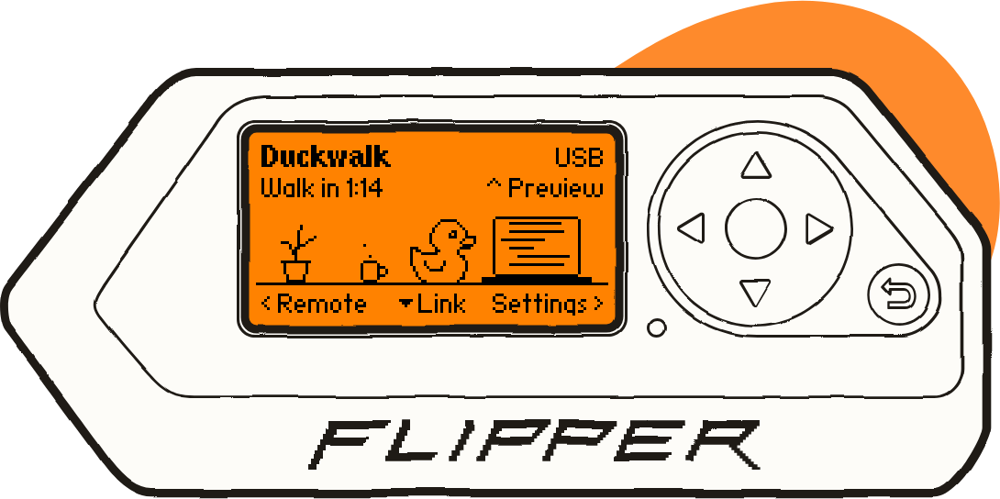
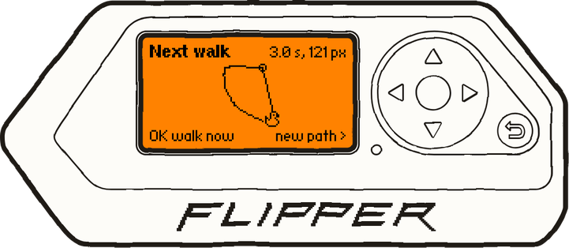
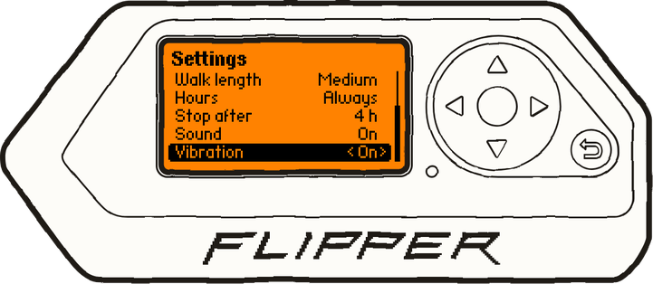
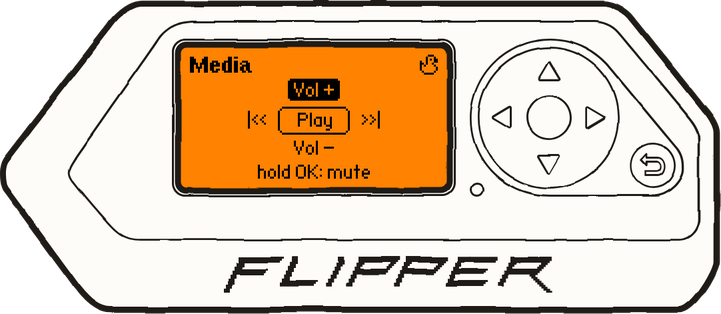
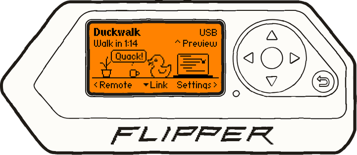
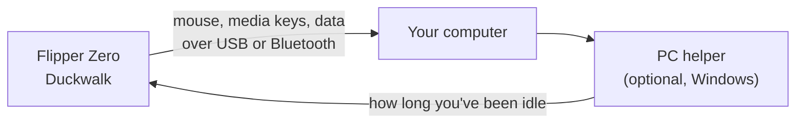

<p align="center">
  
</p>

<h1 align="center">Duckwalk</h1>

<p align="center">
  <strong>A Flipper Zero app that keeps your computer awake, with a rubber debugging duck in charge.</strong>
</p>

<p align="center">
  <a href="https://arudaev.github.io/duckwalk/"></a>
  <a href="https://github.com/arudaev/duckwalk/actions/workflows/build.yml"></a>
  <a href="https://github.com/arudaev/duckwalk/actions/workflows/tests.yml"></a>
  <a href="LICENSE"></a>
</p>

<p align="center">
  <a href="https://arudaev.github.io/duckwalk/"><b>Website</b></a> ·
  <a href="#install"><b>Install</b></a> ·
  <a href="docs/guide.md"><b>User guide</b></a> ·
  <a href="docs/README.md"><b>All docs</b></a>
</p>

Harold lives on your desk. When you step away, he moves the mouse pointer so Teams, the screen saver and the lock timer still see someone there, and he puts it back where it was. Over USB or Bluetooth, no drivers, nothing to install on the computer. The same Flipper is a media, slides and mouse remote.

<p align="center">
  
</p>

> [!NOTE]
> **v0.1 is nearly ready.** It works on official firmware 1.5.1 with Windows 11, over USB and Bluetooth. Until it is in the Flipper Apps Catalog, build it from source (below). Progress: [v0.1 milestone](https://github.com/arudaev/duckwalk/milestone/2).

## Why Duckwalk

<table>
  <tr>
    <td width="33%" align="center" valign="top">
      
      <br><b>USB or Bluetooth</b>
      <br>Plug it in, or pair it and keep it in your pocket. A connection check shows what needs attention.
    </td>
    <td width="33%" align="center" valign="top">
      
      <br><b>Walks like a person</b>
      <br>Random curved paths, never the same twice, always back to where they started.
    </td>
    <td width="33%" align="center" valign="top">
      
      <br><b>Lets go when you're back</b>
      <br>With the optional <a href="desktop/helper/README.md">PC helper</a>, he stops the moment you touch your mouse or keyboard.
    </td>
  </tr>
  <tr>
    <td align="center" valign="top">
      
      <br><b>Knows when to stop</b>
      <br>Work hours only, and <b>Stop after</b> 1 to 8 hours with nobody around, so your PC still locks.
    </td>
    <td align="center" valign="top">
      
      <br><b>A remote, too</b>
      <br>Play, pause, volume and tracks; next and previous slide; a D-pad mouse.
    </td>
    <td align="center" valign="top">
      
      <br><b>Harold has a life</b>
      <br>He reads code, types, sips coffee, hunts bugs and quacks at them.
    </td>
  </tr>
</table>

**Three ways to stay awake**, [shown moving on the website](https://arudaev.github.io/duckwalk/#modes):

- **Walk** takes a short, curved, random walk every few minutes.
- **Subtle** moves one pixel out and back, invisible while you work.
- **Wander** drifts the pointer around without stopping and glides it back to where it started when you turn it off.

## Install

Once v0.1 is out: open the Flipper mobile app or [Flipper Lab](https://lab.flipper.net/apps), go to **USB**, and install **Duckwalk**.

> [!IMPORTANT]
> Duckwalk needs the **official** Flipper firmware, 1.5 or newer.

<details>
<summary><b>Until then: build it from source</b></summary>

You need Python 3.8+ and a Flipper on the official firmware.

```bash
python -m pip install --upgrade ufbt
git clone https://github.com/arudaev/duckwalk.git
cd duckwalk/app
ufbt launch      # builds it and starts it on a connected Flipper (close qFlipper first)
```

</details>

On the first launch Harold asks how to reach the computer: <kbd>←</kbd> for USB, <kbd>→</kbd> for Bluetooth. Bluetooth walks you through pairing on the Flipper's screen.

## Use

| Button | On the Flipper |
|---|---|
| <kbd>OK</kbd> | Wake Harold (keep-awake on) or put him to sleep. Hold to quack |
| <kbd>→</kbd> | Settings: mode, USB or Bluetooth, how often, how far, work hours, Stop after, sound and vibration |
| <kbd>←</kbd> | Remote: media, slides or mouse |
| <kbd>↑</kbd> | Preview: the next walk drawn to scale; <kbd>OK</kbd> plays it now |
| <kbd>↓</kbd> | Connection check: a checklist that shows whether the Flipper or the computer needs attention |
| <kbd>Back</kbd> | Leave Duckwalk; USB and Bluetooth go back to normal |

> [!TIP]
> For a whole day away, set **Stop after** to **Never**. The [user guide](docs/guide.md) shows every screen.

## How it works



Most Flipper apps that talk to a computer turn the USB port into a single device, so a jiggler and a PC monitor cannot run at once. Over USB, Duckwalk is one device with three parts: a mouse, media keys and a small data channel, all standard USB HID. Over Bluetooth it pairs like any Bluetooth mouse, using the firmware's HID profile plus one small data service of Duckwalk's own, and the USB port stays free for charging and qFlipper.

The lock timer and "away" status follow the computer's idle timer, and any mouse input resets it. The [PC helper](desktop/helper/README.md) uses Windows Raw Input to tell your own devices from Duckwalk's and sends one number over the data channel, on USB or Bluetooth: how long you have been idle. The [architecture page](docs/architecture.md) has the details.

## Before you use it at work

> [!CAUTION]
> A keep-awake tool can be against your employer's rules. Duckwalk makes your computer look attended; whether that is acceptable where you work is your decision. It only moves the pointer. It never types, and it clicks or presses media keys only when you use the remote.

## Docs and help

- [User guide](docs/guide.md): every screen, Settings, the remote, pairing
- [PC helper](desktop/helper/README.md): the optional Windows program
- [All docs](docs/README.md), including the [architecture](docs/architecture.md), the [developer guide](docs/development.md) and the [brand](docs/brand.md)
- Found a bug or tried it on macOS or Linux? [Open an issue](https://github.com/arudaev/duckwalk/issues/new/choose).

## Contributing

Testing on other computers, bug reports and art are all welcome. Start with [CONTRIBUTING.md](CONTRIBUTING.md); the [project board](https://github.com/users/arudaev/projects/9) shows what is being worked on.

## Credits

- Harold is the duck from [VOYAGER // 56K](https://arudaev.github.io), a small sailing game by the same author.
- The USB interface follows the structure of the Flipper Zero firmware's own HID driver ([flipperdevices/flipperzero-firmware](https://github.com/flipperdevices/flipperzero-firmware), GPL-3.0).
- The Flipper drawing in these images and on the website is adapted from [qFlipper](https://github.com/flipperdevices/qFlipper) (GPL-3.0). Flipper Zero is a trademark of Flipper Devices Inc.; Duckwalk is not affiliated with them.

## Licence

[GNU General Public License v3.0](LICENSE).
