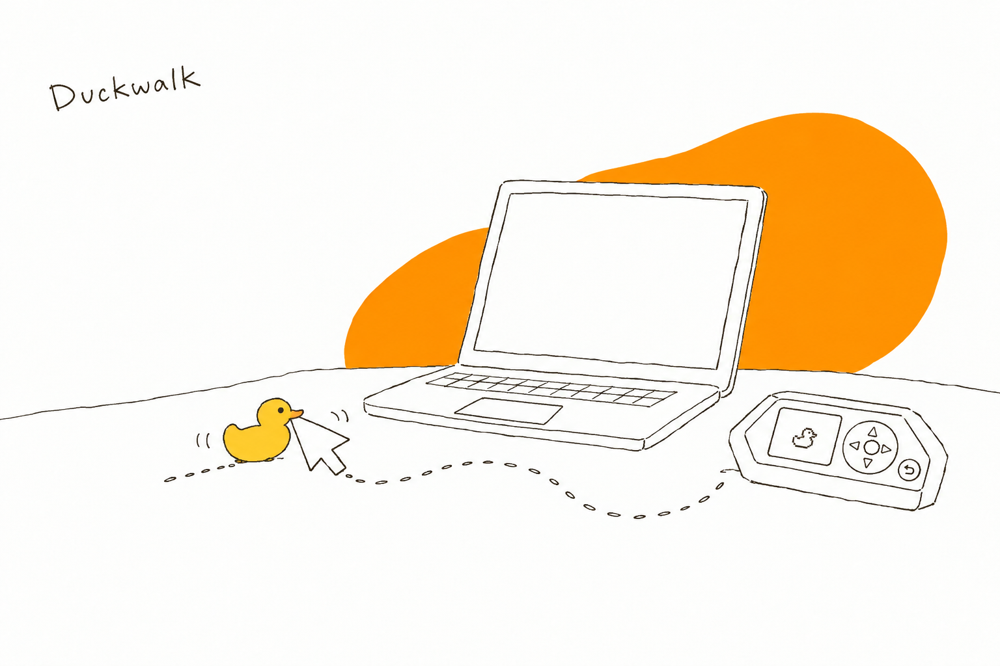

<p align="center">
  
</p>

# Duckwalk

Duckwalk turns a Flipper Zero into Harold, a rubber debugging duck who lives on your desk. When you step away, Harold keeps your computer awake by walking the mouse pointer around, never on the same path twice. When you are working, he leaves the pointer alone. The same Flipper is also a remote for the computer.

It is a Flipper app over USB: there is nothing to install on the computer, and no drivers.

> **Status: in development, not released yet.** The USB design has been tested on a Flipper (official firmware 1.5.1) with Windows 11. Version 0.1 is being built in the open; follow the [M1 milestone](https://github.com/arudaev/duckwalk/milestone/2).

## What Harold does

| On the Flipper | What happens on the computer |
|---|---|
| **Home** – Harold asleep or awake | Keep-awake on or off. In **Walk** mode the pointer takes a short, curved, randomised walk when you are away; in **Subtle** mode it moves one pixel and back |
| **Right** – Settings | Mode, how often, how far, work hours only, sound and vibration |
| **Left** – Remote | Play/pause, next and previous track, volume, presentation next and back, D-pad as a mouse |
| **Up** – Preview | Harold acts out the next walk on the Flipper's screen before it happens |
| **Back** | Leaves the app; USB goes back to normal |

Planned after 0.1: Bluetooth, so Duckwalk works unplugged like a Bluetooth mouse, and an optional desktop app where Harold walks along your taskbar and starts walks only when you are really away.

## How it works

Most Flipper apps that talk to a computer switch the USB port into a single mode, so a mouse jiggler and a PC monitor cannot run at the same time. Duckwalk presents one USB device with three parts: a mouse, media keys and a small data channel. All three are standard USB HID, which computers support without extra drivers; so far it has been tested on Windows 11, and macOS and Linux reports are welcome.

Teams, screen savers and lock timers decide you are away from the computer's idle timer, and any mouse input resets it. In our test the idle timer reset with every move while the data channel was busy.

## Install

Once version 0.1 is out, Duckwalk will be in the official Flipper Apps Catalog: install it from the Flipper mobile app or [Flipper Lab](https://lab.flipper.net/apps).

Until then, build it from source. You need Python 3.8+ and a Flipper on the official firmware.

```bash
python -m pip install --upgrade ufbt
git clone https://github.com/arudaev/duckwalk.git
cd duckwalk/app
ufbt launch      # builds and starts it on a connected Flipper (close qFlipper first)
```

## Before you use it at work

A keep-awake tool can be against your employer's rules. Duckwalk makes your computer look attended; whether that is acceptable where you work is your decision. On its own it only moves the pointer. It never types, and it clicks or presses media keys only when you use the remote.

## Contributing

Issues, testing on other computers, and art are welcome. Start with [CONTRIBUTING.md](CONTRIBUTING.md).

## Credits

- Harold is the duck from [VOYAGER // 56K](https://arudaev.github.io), a small sailing game by the same author.
- The USB interface follows the structure of the Flipper Zero firmware's own HID driver ([flipperdevices/flipperzero-firmware](https://github.com/flipperdevices/flipperzero-firmware), GPL-3.0).

## Licence

[GNU General Public License v3.0](LICENSE).
