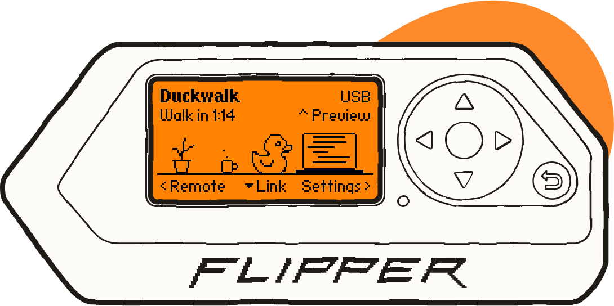

# Duckwalk

**A Flipper Zero app that keeps your computer awake, with a rubber debugging duck in charge.**

<p align="center">
  
</p>

[](https://github.com/arudaev/duckwalk/actions/workflows/build.yml)
[](https://github.com/arudaev/duckwalk/actions/workflows/tests.yml)
[](https://github.com/arudaev/duckwalk/actions/workflows/desktop-app.yml)
[](LICENSE)

[Website](https://arudaev.github.io/duckwalk/) · [Install](#install) · [User guide](docs/guide.md) · [All docs](docs/README.md)

Harold lives on your desk. When you step away, he moves the mouse pointer so Teams, the screen saver and the lock timer still see someone there, and he puts it back where it was. Never the same path twice, so it does not look like a jiggler. Over USB or Bluetooth, no drivers, nothing to install on the computer. The same Flipper is a media, slides and mouse remote.

> [!NOTE]
> **v0.1-rc1 is out**, a preview of the first release. It is built for the official firmware 1.5.1 (API 88.2) and tested with Windows 11, over USB and Bluetooth. Custom firmware such as Momentum or Unleashed isn't supported, because it hasn't been tested; if you try it anyway, [say how it went](https://github.com/arudaev/duckwalk/issues/new/choose). Progress: [v0.1 milestone](https://github.com/arudaev/duckwalk/milestone/2).

## Why Duckwalk

- **It does not look like a jiggler.** Three ways, never the same path twice. **Walk** takes a short, curved, random walk every few minutes. **Subtle** moves one pixel out and back, invisible while you work. **Wander** drifts the pointer around without stopping and glides it back to where it started when you turn it off. [See them move.](https://arudaev.github.io/duckwalk/#modes)
- **USB or Bluetooth.** Plug it in, or pair it and keep it in your pocket. A connection check shows whether the Flipper or the computer needs attention.
- **Stops when you want it to.** Work hours only (Mon–Fri 8–18), and **Stop after** puts Harold to sleep when nobody has been around for 1 to 8 hours, so a PC you walked away from still locks.
- **Lets go while you work.** With the optional [desktop app](desktop/app/README.md) for Windows, macOS and Linux, Harold pauses the moment you touch your own mouse or keyboard, over USB or Bluetooth. It lives in the tray and starts at login.
- **A remote too.** Play, pause, volume and tracks; next and previous slide; a D-pad mouse.
- **Under the hood.** Over USB it is one device with a mouse, media keys and a data channel. The walks, timers and settings are unit-tested on a computer, and every screen is rendered from the app's own drawing code on each change, so the screenshots in these docs are the real thing. [How it works.](#how-it-works)
- **Harold is good company.** He reads code, types, sips coffee, hunts bugs and quacks at them.

## Install

1. Update the Flipper to the official firmware, 1.5.1 or newer, with [qFlipper](https://flipper.net/pages/downloads).
2. Download [`duckwalk.fap`](https://github.com/arudaev/duckwalk/releases/download/v0.1-rc1/duckwalk.fap) (v0.1-rc1).
3. In qFlipper's file manager, drag it into **SD Card > apps > USB**.
4. On the Flipper: **Apps > USB > Duckwalk**. On the first launch Harold asks how to reach the computer: **Left** for USB, **Right** for Bluetooth. Bluetooth walks you through pairing on the Flipper's screen.

The [install guide](docs/install.md) has every step and the optional desktop app for Windows, macOS and Linux. Once Duckwalk is in the Flipper Apps Catalog, you can also install it from the **USB** category of the Flipper mobile app or [Flipper Lab](https://lab.flipper.net/apps).

**Build it yourself** with [ufbt](https://github.com/flipperdevices/flipperzero-ufbt), Flipper's official build tool. The short version, on Windows with Python 3.8 or newer, the Flipper plugged in and qFlipper closed (macOS and Linux need a few more steps: see [Or build it yourself](docs/install.md#or-build-it-yourself)):

```bash
python -m pip install --upgrade ufbt
git clone https://github.com/arudaev/duckwalk
cd duckwalk/app && python -m ufbt launch
```

<details>
<summary><b>Or let your coding agent install it</b></summary>

Your own coding agent, working on your computer (in your terminal or code editor, not a chat in the browser), can read the code for you and say what it couldn't check, then install everything and test that it really works on your computer and your Flipper. If something doesn't, it helps you report it, so it gets fixed for setups like yours. Plug in the Flipper and paste this to it:

```text
Install Duckwalk on this computer and my plugged-in Flipper Zero by following https://raw.githubusercontent.com/arudaev/duckwalk/main/docs/agents/install.md. Check the code for me, ask before you change anything, test that it all works here, and help me report anything that doesn't to the maintainer.
```

It follows the [install guide for coding agents](docs/agents/install.md) and asks you before every change.

</details>

## Use

| Button | On the Flipper |
|---|---|
| **OK** | Wake Harold (keep-awake on) or put him to sleep. Hold to quack |
| **Right** | Settings: mode, USB or Bluetooth, how often, how far, Resume after, work hours, Stop after, Baby lock, sound and vibration |
| **Left** | Remote: media, slides or mouse |
| **Up** | Preview: the next walk drawn to scale; OK plays it now |
| **Down** | Connection check: a checklist that shows whether the Flipper or the computer needs attention |
| **Back** | Leave Duckwalk; USB and Bluetooth go back to normal. With Baby lock on: tap twice, or hold for 2 seconds |

The opposite button brings you back: Down from Preview, Up from the connection check, Right from the Remote's menu.

The Flipper app needs nothing installed on the computer: it shows up as a normal USB or Bluetooth mouse, so it works with any computer that takes one. So far it has been tested on Windows 11.

For a whole day away, set **Stop after** to **Never**. The [user guide](docs/guide.md) shows every screen.

## How it works

Most Flipper apps that talk to a computer turn the USB port into a single device, so a jiggler and a PC monitor cannot run at once. Over USB, Duckwalk is one device with three parts: a mouse, media keys and a small data channel, all standard USB HID ([USB device](docs/usb-device.md) has the descriptor and IDs; its ID, `1209:D0C4`, is requested from pid.codes and still pending). Over Bluetooth it pairs like any Bluetooth mouse, using the firmware's HID profile plus one small data service of Duckwalk's own, and the USB port stays free for charging and qFlipper.

The lock timer and "away" status follow the computer's idle timer, and any mouse input resets it. The [desktop app](desktop/app/README.md) asks the system which device each input came from (Raw Input on Windows, IOHIDManager on macOS, evdev on Linux) to tell your own devices from Duckwalk's and sends one number over the data channel, on USB or Bluetooth: how long you have been idle. The [architecture page](docs/architecture.md) has the diagrams.

## Before you use it at work

> [!CAUTION]
> A keep-awake tool can be against your employer's rules. Duckwalk makes your computer look attended; whether that is acceptable where you work is your decision. It only moves the pointer. It never types, and it clicks or presses media keys only when you use the remote.

## Docs and help

- [User guide](docs/guide.md): every screen, Settings, the remote, pairing
- [Desktop app](desktop/app/README.md): the optional tray app for Windows, macOS and Linux, with an MCP server and an [agent skill](skills/duckwalk/SKILL.md) for coding agents
- [All docs](docs/README.md), including the [architecture](docs/architecture.md) and [developer guide](docs/development.md)
- Found a bug or tried it on macOS or Linux? [Open an issue](https://github.com/arudaev/duckwalk/issues/new/choose).

## Contributing

Testing on other computers, bug reports and art are all welcome. Start with [CONTRIBUTING.md](CONTRIBUTING.md); the [project board](https://github.com/users/arudaev/projects/9) shows what is being worked on.

## Credits

- Harold is the duck from [VOYAGER // 56K](https://arudaev.github.io), a small sailing game by the same author.
- The USB interface follows the structure of the Flipper Zero firmware's own HID driver ([flipperdevices/flipperzero-firmware](https://github.com/flipperdevices/flipperzero-firmware), GPL-3.0).
- The Flipper drawing in the animation and on the website is adapted from [qFlipper](https://github.com/flipperdevices/qFlipper) (GPL-3.0). Flipper Zero is a trademark of Flipper Devices Inc.; Duckwalk is not affiliated with them.

## Licence

[GNU General Public License v3.0](LICENSE).
