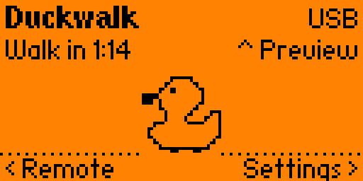
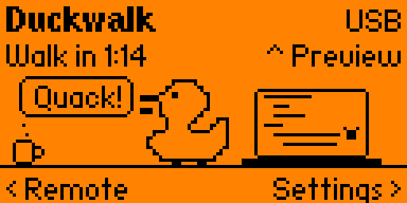
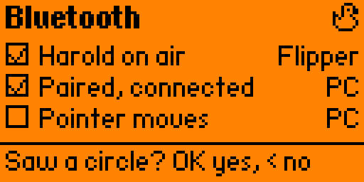

# Duckwalk docs

[← Duckwalk](../README.md) · [Start: User guide →](guide.md)

Start here. Every page about Duckwalk is linked from this one, in reading order, and each page links back here and on to the next.

<p align="center">
  
  
  
</p>

## I want to use Duckwalk

| Order | Page | Question answered |
|---|---|---|
| **01** | [User guide](guide.md) | What does every screen and button do, and how do I connect over USB or Bluetooth? |
| **02** | [Desktop app](../desktop/app/README.md) | How does Harold know I'm back at the computer? |

What Duckwalk is and how to install it: the [README](../README.md).

## I want to work on Duckwalk

| Order | Page | Question answered |
|---|---|---|
| **03** | [Contributing](../CONTRIBUTING.md) | How do I set up, and what keeps `main` releasable? |
| **04** | [Architecture](architecture.md) | How is the app put together: files, threads, the link to the computer? |
| **05** | [Developer guide](development.md) | How do I build, run, debug and test it? |
| **06** | [Screen simulator](../sim/README.md) | How do I see every screen without a Flipper? |
| **07** | [Issues, branches and PRs](contributing/README.md) | Which labels, milestones and commit conventions do we use? |
| **08** | [Project board](contributing/project-board.md) | How is the work tracked? |
| **09** | [Brand](brand.md) | Which colours, type and drawings do we use? |
| **10** | [Sound design](sound-design.md) | What does each sound need to be, and how do I deliver it? |
| **11** | Decisions: [0001](decisions/0001-tell-duckwalk-from-the-user.md), [0002](decisions/0002-one-desktop-app-in-rust.md), [0003](decisions/0003-trusted-install-for-free.md) | Why are things the way they are? |
| **12** | [Code signing](code-signing.md) | Why the Windows builds aren't signed yet, and what Duckwalk sends over the network (nothing) |
| **13** | [USB device](usb-device.md) | What does Duckwalk look like over USB, on which hardware, and why does it have its own USB ID? |

## Where things are

```
app/            the Flipper app (C, built with ufbt)
  usb/          the composite USB device: mouse, media keys, data channel
  images/       Harold's sprites (made by brand/tools/make_brand.py)
desktop/app/    the desktop app for Windows, macOS and Linux (Rust)
tests/          host tests for the app's logic
sim/            the screen simulator
brand/          banner, sprite sources and the tool that draws the sprites
docs/           these pages; screens/ holds the simulator's renders
```

## The plan

| Milestone | What it brings | |
|---|---|---|
| **M1** v0.1 | The first release: Harold, Walk, Subtle and Wander keep-awake over USB or Bluetooth, Settings with Stop after, Remote, Preview, the connection check, the PC helper over USB or Bluetooth; Apps Catalog listing | [milestone](https://github.com/arudaev/duckwalk/milestone/2) |
| **M3** v0.3 | One desktop app for Windows, macOS and Linux: seeing your input on every system, the tray, Wander that knows the screen edges, then Harold on the computer screen | [milestone](https://github.com/arudaev/duckwalk/milestone/4) |
| **M4** | Harold's extra jobs | [milestone](https://github.com/arudaev/duckwalk/milestone/5) |

The [project board](https://github.com/users/arudaev/projects/9) shows what is being worked on right now.
