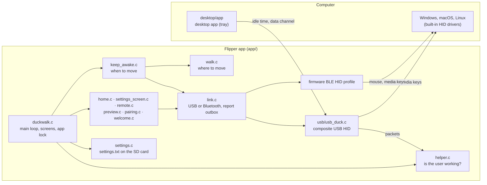
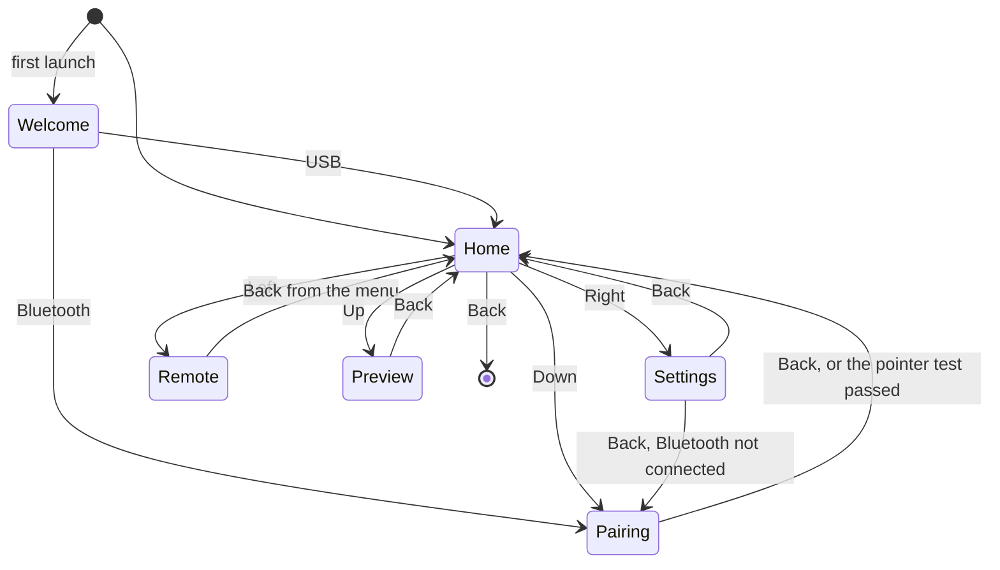
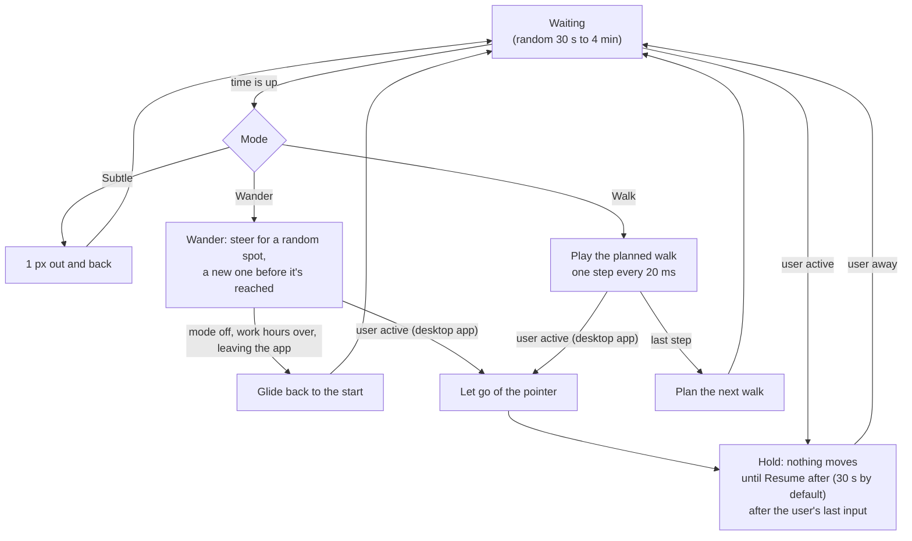

# 04 · Architecture

[← Contributing](../CONTRIBUTING.md) · [Docs home](README.md) · [Next: Developer guide →](development.md)

How the Duckwalk app is put together. Read this before changing anything that runs on more than one thread, or anything that talks to the computer.

## The pieces



| File | Owns |
|---|---|
| `duckwalk.c` | The app's life: start-up, the main loop, which screen is up, slow work outside the lock, shutdown |
| `duckwalk.h` | The app state every screen shares, and the rules for touching it |
| `home.c` and the other screens | Drawing (`*_draw`), buttons (`*_input`) and animation (`*_tick`) for one screen each |
| `keep_awake.c` | When to nudge or walk; plays a walk one 20 ms step at a time |
| `walk.c` | Plans a walk: a smooth curve through random waypoints that ends where it started |
| `link.c` | The connection: starts USB or Bluetooth, queues reports and sends them, carries dropped moves into the next report |
| `usb/usb_duck.c` | One USB HID interface with three parts: mouse, media keys and a 63-byte data channel |
| `ble_duck.c` | The Bluetooth profile: the firmware's HID mouse and media keys, plus a one-characteristic service the desktop app writes to |
| `helper.c`, `helper_protocol.h` | Packets from the desktop app; the protocol both sides share (`desktop/app/src/protocol.rs` mirrors it) |
| `settings.c` | Reading and writing `settings.txt`, defaults line by line |
| `util.h` | The log tag and tick helpers that survive the counter wrapping |

## Threads and the app lock

Four threads touch Duckwalk. Each has one job. The rule that keeps them apart: **nothing holds the app lock while it waits for something slow.**

```mermaid
sequenceDiagram
    participant In as Input service
    participant Main as Main loop (duckwalk.c)
    participant GUI as GUI thread
    participant Link as USB interrupt / Bt service

    In->>Main: button event (queue, never blocks)
    Note over Main: lock: input, ticks, state changes,<br/>reports go into the outbox
    Main->>Main: unlock
    Main->>Link: send the outbox, switch connection, save settings
    GUI->>Main: draw: lock for at most 25 ms, read state, unlock
    Link-->>Main: status / data-channel packets (one word each)
```

- **Main loop:** handles input, runs every screen's tick and keep-awake, all under the lock. Then, without the lock, it does the slow work the screens asked for (`app->pending`) and sends the queued reports (`link_flush`).
- **GUI thread:** calls the draw callback, which waits at most 25 ms for the lock and skips a frame if it can't get it. Draw functions only read state.
- **Input service:** puts button events in a queue and never waits.
- **USB interrupt and Bt service:** store a connection status or a data-channel packet; the other threads only read them.

The loop wakes every 20 ms while something moves (a walk, the Remote's mouse, queued reports) and every 100 ms otherwise, so the Flipper can idle.

**Why so strict:** when a computer pairs over Bluetooth, the firmware shows a "confirm the code" dialog. While that dialog waits, the Bluetooth layer holds its own lock. An app that waits on the Bluetooth layer from the GUI thread, or makes the GUI wait for it, stops the dialog from ever being drawn, and the Flipper freezes until it is rebooted. Duckwalk did exactly that once. That's why the Bluetooth state comes only from the Bt service's status messages, never from `furi_hal_bt_*` queries, and why drawing never blocks.

## Screens and buttons



## Keep-awake and walks



A walk is planned before it plays, so Preview shows the path that will really play. If a report doesn't get through, its movement is added to the next one (`link.c`), so a walk always ends where it started. A wander isn't planned: `wander.c` works out each step from where the cursor is, turning a little at a time so it moves in arcs, and keeps count of what it sent, so going home lands exactly on the start.

## The data channel

Over USB, Duckwalk's HID interface has a third collection: 63-byte vendor reports in both directions. The desktop app writes the user's idle time into it once a second, and says goodbye when it quits so the Flipper drops +PC at once; the format is in [`app/helper_protocol.h`](../app/helper_protocol.h). Over Bluetooth the same packets go to a service of Duckwalk's own (`ble_duck.c`): one write-only characteristic, 63 bytes, writable only by the paired computer. The firmware's serial service would have done, but its two 486-byte buffers don't fit beside the HID service. The profile wraps the firmware's HID profile, so its mouse and media functions work unchanged, and Windows picks the new service up without pairing again.

How the desktop app tells Duckwalk's own input from yours is written up in [decision 0001](decisions/0001-tell-duckwalk-from-the-user.md) and [decision 0002](decisions/0002-one-desktop-app-in-rust.md).

---

[← Contributing](../CONTRIBUTING.md) · [Docs home](README.md) · [Next: Developer guide →](development.md)
