# 01 · User guide

[Docs home](README.md) · [Next: PC helper →](../desktop/helper/README.md)

Duckwalk turns a Flipper Zero into Harold, a rubber debugging duck who keeps your computer awake. When you step away, he walks the mouse pointer on a short, random path, so Teams, the screen saver and the lock timer see someone at the desk. The same Flipper works as a remote for the computer.

All pictures on this page come from the app's own drawing code ([screen simulator](../sim/README.md)).

## The first launch

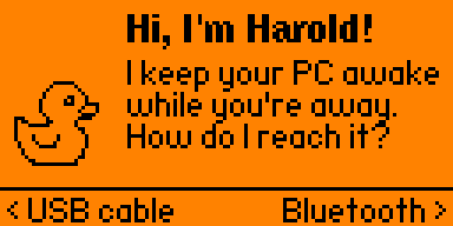

Harold asks how to reach your computer. **Left** for a USB cable, **Right** for Bluetooth. Bluetooth goes straight on to pairing (below). **Back** leaves without choosing; he asks again next time.

## Home: Harold at his desk

| | |
|---|---|
| 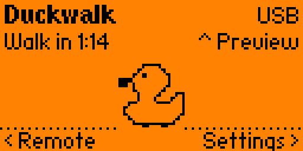 | **Keeping the computer awake.** Harold reads code on his laptop and the status line counts down to the next walk. Every few seconds he types, sips his coffee, looks round or bounces. Now and then he finds a bug, quacks at it and fixes it. |
| 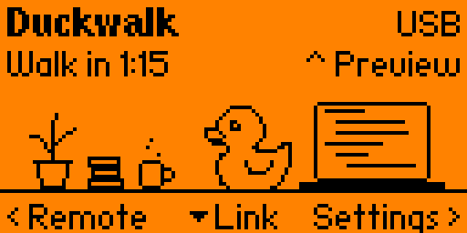 | **A coffee break.** He turns to his mug and the steam picks up. |
| 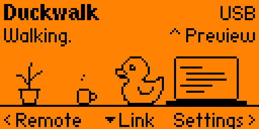 | **Walking.** The pointer takes a short, curved walk and comes back to where it started. Harold walks along on the screen. |
| 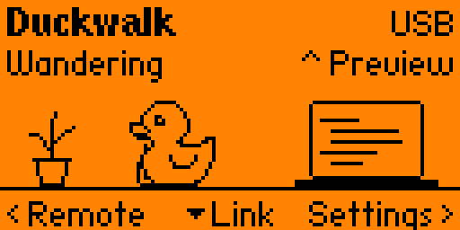 | **Wandering.** In Wander mode the pointer drifts around without stopping, and Harold drifts with it. |
| 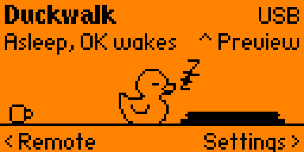 | **Asleep.** Keep-awake is off. **OK** wakes him; OK again puts him to sleep. |
| 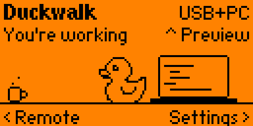 | **You're working.** With the [PC helper](../desktop/helper/README.md) running, Harold lets go of the pointer while you use your own mouse or keyboard, and waits 30 seconds after you stop (**Resume after** in Settings). |

| Button | Does |
|---|---|
| OK | Sleep or wake |
| Hold OK | Quack |
| Right | Settings |
| Left | Remote |
| Up | Preview the next walk |
| Down | Connection check: is Harold reaching the computer? |
| Back | Leave Duckwalk; USB and Bluetooth go back to normal. With Baby lock on: tap twice, or hold for 2 seconds |

The corner shows the connection: **USB**, **BT**, **BT pairing**, **no USB**. **+PC** means the PC helper is talking to Duckwalk.

## Settings

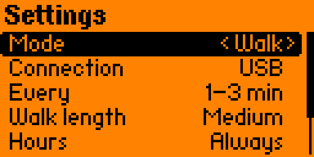

| Setting | Choices |
|---|---|
| Mode | Walk (a short random walk), Subtle (one pixel out and back), Wander (the pointer drifts around without stopping), Off |
| Connection | USB or Bluetooth |
| Every | 30–60 s, 1–3 min, 2–4 min between walks (Wander doesn't wait) |
| Walk length | Short, Medium, Long: how far a walk or a wander strays |
| Hours | Always, or Mon–Fri 8–18 only |
| Stop after | 1 h, 2 h, 4 h (default), 8 h, Never: Harold goes to sleep when nobody has pressed a button on the Flipper (or, with the PC helper, used the computer) for that long, so a computer you walked away from still locks. The home screen then says **You were away**; **OK** wakes him. Without the helper only the Flipper's buttons count, even while you work at the computer. For a whole day away, choose **Never** |
| Resume after | 10 s, 30 s (default), 1 min, 2 min, 5 min: with the PC helper, how long Harold waits after your last own input before he takes the pointer again |
| Sound | Off, Cues (default), Lively: see [Sounds](#sounds) |
| Vibration | On or Off: a buzz for the two warnings, Stop after and a lost connection |
| Baby lock | Off (default) or On: Back leaves only on a double tap or a 2-second hold, so a stray press doesn't close Duckwalk |

Up and Down choose, Left and Right change. Settings are saved on the SD card in `apps_data/duckwalk/settings.txt`.

## Sounds

| Sound | When | Heard on |
|---|---|---|
| A quack, modelled on a recorded duck | You hold OK | Cues, Lively |
| Three notes up or down | OK wakes Harold or puts him to sleep | Cues, Lively |
| A yawn, and a buzz | Stop after ran out and Harold went to sleep | Cues, Lively |
| Two notes down, and a buzz | The computer went away for more than 3 seconds, while Harold is awake | Cues, Lively |
| Two notes up | It came back | Cues, Lively |
| "Huh?", a quack, a ding | The bug hunt: he spots a bug, quacks at it and fixes it | Lively |
| Boing | A happy little hop | Lively |
| Pit-pat | His footsteps during a walk (a wander stays quiet) | Lively |
| Tick | Subtle's one pixel | Lively |

Harold's own sounds play only while he is on screen. The Flipper's volume and its mute (stealth mode) apply to all of them; the Flipper's own vibration setting can switch the buzz off too.

## Remote

| | | |
|---|---|---|
| 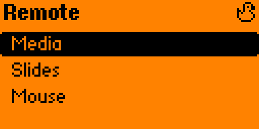 | 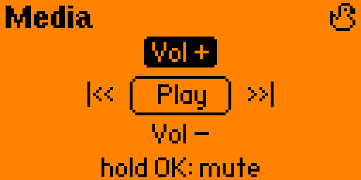 | 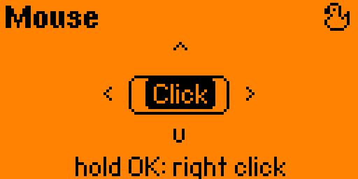 |

- **Media:** Up and Down change the volume, Left and Right skip tracks, OK plays or pauses, holding OK mutes.
- **Slides:** Right and Left go to the next and previous slide, by scrolling. PowerPoint and most PDF viewers follow it.
- **Mouse:** the D-pad moves the pointer and speeds up while you hold it; OK clicks, holding OK right-clicks.

Keep-awake keeps running while the Remote is open.

## Preview

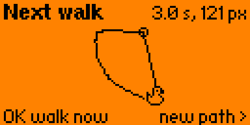

The next walk, drawn to scale, with a small Harold tracing it at the speed it will play. **OK** plays it on the computer now; **Right** plans a different one.

## Connecting over Bluetooth

Choose **Bluetooth** on the first launch or in Settings. Duckwalk shows a checklist that ticks itself off as the connection comes up. The first open box tells you which side needs attention.

| | |
|---|---|
| 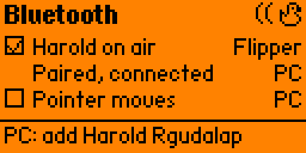 | **Harold on air** is ticked: the Flipper is ready. On the computer, open **Bluetooth > Add device > Bluetooth** and pick the name at the bottom, for example **Harold Rgudalap**. |
| 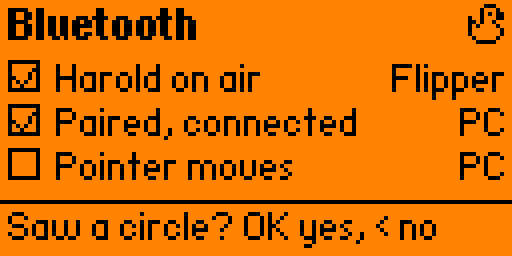 | **Paired, connected** is ticked. Press **OK** and Harold draws a small circle with your pointer. Saw it? **OK** for yes. |
| 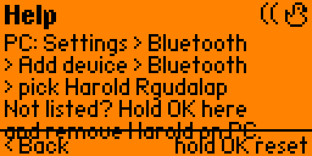 | Stuck? **Right** shows the fix for the open box. |

When the Flipper asks you to confirm a code, check it matches the one on the computer and press **OK** on both. After the first time, the computer reconnects by itself whenever Duckwalk runs in Bluetooth mode. In Bluetooth mode the USB port stays a normal Flipper port, so charging and qFlipper keep working.

**Starting over:** hold **OK** on the checklist to forget every paired computer, and remove Harold in the computer's Bluetooth settings too.

## Checking the connection

**Down** on the home screen opens the same checklist for whichever connection you use. Over USB it reads **Harold has USB**, **PC sees Harold**, **Pointer moves**, and **Right** explains the open box (another app holding the port, a charge-only cable). Once everything is ticked, the last line says whether the [PC helper](../desktop/helper/README.md) is running, which is what lets Harold pause while you work.

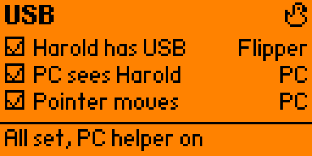

## Before you use it at work

A keep-awake tool can be against your employer's rules. Duckwalk makes your computer look attended; whether that is acceptable where you work is your decision.

---

[Docs home](README.md) · [Next: PC helper →](../desktop/helper/README.md)
