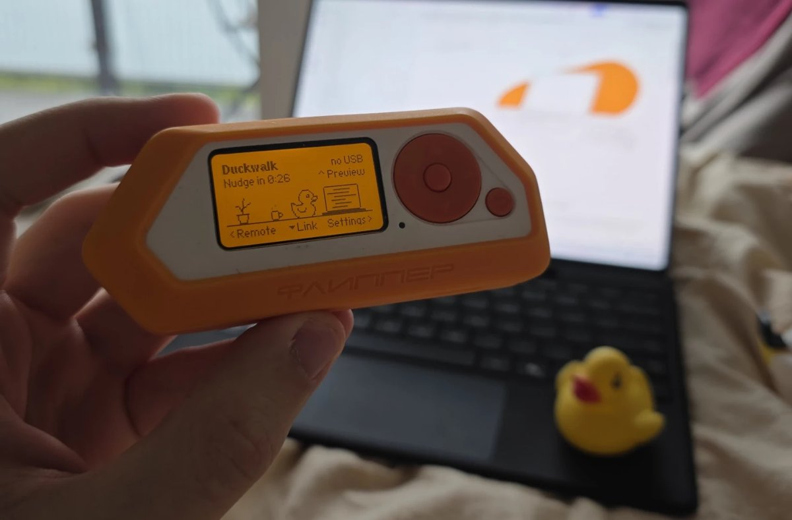

# USB device

[Docs home](README.md)

What Duckwalk looks like to a computer over USB, which hardware it runs on, and where its USB IDs live in the source. This page is the one the [pid.codes](https://pid.codes/) entry for Duckwalk links to.

## Hardware

Duckwalk is software only. It runs on an unmodified [Flipper Zero](https://flipperzero.one/) with the official firmware (1.5 or newer), plugged into the computer with a USB-C cable. There is no extra board, no wiring and nothing to solder.

  

<em>Duckwalk on a Flipper Zero. Here the cable is out, so the status corner reads "no USB"; plugged in, the Flipper shows up as the USB device described below.</em>

| | |
|---|---|
| Device | Flipper Zero, any hardware revision sold by Flipper Devices |
| Microcontroller | STM32WB55RG (Arm Cortex-M4 application core, Cortex-M0+ radio core) |
| USB | Full-speed device on the STM32WB55's own USB peripheral, USB-C connector |
| Schematics | Published by Flipper Devices as PDFs for every board, including the STM32WB55 MCU sheet: [Flipper Zero schematics](https://docs.flipper.net/zero/development/hardware/schematic), [technical specifications](https://docs.flipper.net/zero/development/hardware/tech-specs) |
| Firmware | Official Flipper Zero firmware, [flipperdevices/flipperzero-firmware](https://github.com/flipperdevices/flipperzero-firmware), GPL-3.0 |

Duckwalk is an app (`.fap`) that the firmware loads from the SD card. While it runs over USB, it replaces the Flipper's normal USB device (serial console) with its own; when you leave the app, the firmware's own device comes back.

## The USB device

One configuration, one HID interface with an interrupt IN and an interrupt OUT endpoint, and three top-level collections:

| Report ID | Collection | Used for |
|---|---|---|
| 2 | Mouse (buttons, X, Y, wheel) | Walking the pointer, the mouse remote |
| 3 | Consumer control | Media and slide keys in the remote |
| 4 | Vendor-defined, usage page `0xFF00`, 63 bytes each way | The data channel to the [desktop app](../desktop/app/README.md) |

Strings: manufacturer `arudaev`, product `Duckwalk`, no serial number. All three collections are standard USB HID, so no driver is needed on Windows, macOS or Linux.

The descriptor is in [`app/usb/usb_duck.c`](../app/usb/usb_duck.c), the IDs and report numbers in [`app/usb/usb_duck.h`](../app/usb/usb_duck.h).

## Why it has its own product ID

The [desktop app](../desktop/app/README.md) has to tell Duckwalk's input apart from yours. It finds the Flipper by its vendor and product ID: to open the data channel, and to ignore Duckwalk's own mouse when it decides whether you are at the computer ([decision 0001](decisions/0001-tell-duckwalk-from-the-user.md)). That only works if the ID belongs to Duckwalk alone:

- the pid.codes test IDs (`1209:0001`) are shared with every other project in development, so the desktop app would mistake someone else's test device for Harold;
- the Flipper's own IDs belong to its normal serial device, which Duckwalk replaces while it runs;
- every user runs the same app on the same hardware, so one ID for the whole project is enough, and per-user IDs would not work.

## Where the IDs are in the source

Development builds use the pid.codes test IDs `1209:0001`. Once pid.codes assigns Duckwalk's own ID, these change together, in one pull request, before v0.1:

| Part | File | Constant |
|---|---|---|
| Flipper app | [`app/usb/usb_duck.h`](../app/usb/usb_duck.h) | `USB_DUCK_VID`, `USB_DUCK_PID` |
| Desktop app, data channel | [`desktop/app/src/usb.rs`](../desktop/app/src/usb.rs) | `VID`, `PID` |
| Desktop app, input sources | [`desktop/app/src/input/mod.rs`](../desktop/app/src/input/mod.rs), [`desktop/app/src/input/windows.rs`](../desktop/app/src/input/windows.rs) | `DUCKWALK_VID`, `DUCKWALK_PID`, `DUCKWALK_USB` |

## Licence

Everything in this repository, the Flipper app and the desktop app, is GPL-3.0: see [LICENSE](../LICENSE). Bluetooth needs no USB IDs and is not covered here; see the [architecture page](architecture.md).
