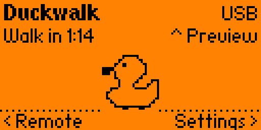
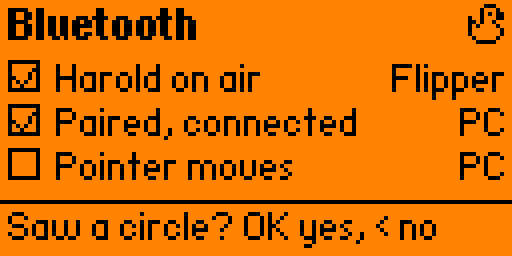

# 06 · Screen simulator

[← Developer guide](../docs/development.md) · [Docs home](../docs/README.md) · [Next: Issues, branches and PRs →](../docs/contributing/README.md)

Renders every Duckwalk screen on a computer, from the app's own draw code, so you can check a layout change and put real screenshots in a pull request without a Flipper. CI runs it on every pull request and uploads the pictures as the `duckwalk-screens` artifact.

| Home | Pairing checklist |
|---|---|
|  |  |

## How it works

The Flipper draws its screen with [u8g2](https://github.com/olikraus/u8g2). `sim/canvas.c` implements the firmware's canvas calls with the same u8g2 calls and fonts as the firmware's `applications/services/gui/canvas.c`, so text measures and breaks exactly as on the device. The screens (`home.c`, `settings_screen.c`, `remote.c`, `preview.c`, `pairing.c`, `welcome.c`) are compiled unchanged; the connection is faked (`link_fake.c`) and the clock is set by each scene. Sprites are read from `app/images`.

`main.c` lists the scenes. Each one starts from a freshly launched app, presses buttons and lets time pass, then draws one frame. The run fails if any text runs past the edge of the screen.

## Run it

You need a C compiler, CMake, zlib, and the firmware's `lib/u8g2` folder (only that folder, about 2 MB):

```bash
git clone --depth 1 --branch 1.5.1 --filter=blob:none --sparse https://github.com/flipperdevices/flipperzero-firmware fw
git -C fw sparse-checkout set lib/u8g2
cmake -S sim -B build/sim -DU8G2_DIR=fw/lib/u8g2
cmake --build build/sim
build/sim/duckwalk_sim build/screens
```

On Windows, use MinGW gcc (`-DCMAKE_C_COMPILER=gcc`); it brings zlib.

## Add a scene

Write a setup function in `main.c` that gets the app into the state (press buttons with `press()`, let time pass with `run_for()`, set the connection with `sim_link`) and add it to `scenes[]`.

---

[← Developer guide](../docs/development.md) · [Docs home](../docs/README.md) · [Next: Issues, branches and PRs →](../docs/contributing/README.md)
